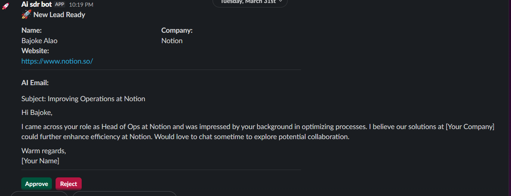

# 🤖 AI-SDR: Human-in-the-Loop Lead Generation System

---

## 🚀 Overview

AI-SDR is a sophisticated **Sales Development Representative (SDR) automation engine** that leverages modern LLMs (GPT-4 / DeepSeek) to generate **hyper-personalized cold outreach emails**.

What makes this system powerful is its **Human-in-the-Loop (HITL)** design — every AI-generated email is **reviewed and approved in Slack before being sent via Gmail**, ensuring quality, brand safety, and domain protection.

---

## 🎥 Project Demo

> https://www.loom.com/share/97c4f3df8f5b4642aabd1195b94a67a1

---

## 🛠️ Technical Stack

* **Orchestration:** Make.com
* **AI Engine:** OpenAI / DeepSeek (via OpenRouter)
* **Interface:** Slack (Custom App + Block Kit)
* **CRM / Database:** Airtable
* **Communication Layer:** Gmail API

---

### 🖥️ User Interface & Experience
To ensure a clean workflow and prevent duplicate outreach, the system dynamically updates the Slack interface using the `chat.update` API.


| Before Action | After Approval |
| :--- | :--- |
|  |  |

> **Logic:** Once the 'Approve' or 'Reject' button is clicked, the interactive elements are removed and replaced with a permanent status log. This creates an immutable audit trail within the Slack channel.


## 🧠 System Architecture

This system uses a **decoupled two-scenario architecture** to handle asynchronous approvals and maintain scalability.

---

### 1️⃣ The Dispatcher (Scenario 1)

**Trigger:**

* Incoming leads via HTTP webhook / automation pipeline

**Flow:**

1. Lead data is received
2. AI generates a personalized cold email
3. Data is formatted and sent to Slack for review

**Key Innovation — Payload Engineering:**
Slack buttons are engineered with embedded metadata:

```
value = "email|company|name"
```

This allows:

* Stateless processing in Scenario 2
* No need for database lookups
* Faster and cleaner execution

---

### 2️⃣ The Processor (Scenario 2)

**Trigger:**

* Slack Interactivity Webhook (button click)

**Flow:**

1. User clicks **Approve** or **Reject**
2. System parses the AI-generated email
3. Approved emails are sent via Gmail
4. Slack message is updated to prevent duplicate actions

---

### 🧩 Regex Engineering

To convert unstructured AI output into structured email fields:

```
Subject:\s*(.*)\n\n?([\s\S]*)
```

**Output:**

* Group 1 → Email Subject
* Group 2 → Email Body

---

### 🔄 State Management

After approval:

* Slack message is updated via `chat.update`
* Buttons are removed
* Status is changed to:

```
✅ Sent
```

This prevents:

* Duplicate sends
* Multi-user collisions
* Workflow inconsistencies

---

## 🖥️ User Interface & Experience

The system is designed with **strict human validation controls**:

### ✋ Awaiting Approval

* AI-generated email displayed in Slack
* Approve / Reject buttons available

### ✅ Post-Approval State

* Buttons removed
* Status updated to “Sent”
* Clean audit trail maintained

---

### 🎯 UX Principles

* **No email is sent without human approval**
* **Clear state transitions**
* **Collision prevention across teams**
* **Minimal UI clutter after action**

---

## 🛡️ Reliability & Error Handling

### 🔁 Break Directive (Fail-Safe System)

* Applied to critical nodes (AI + Gmail)
* Retry logic:

  * 3 attempts
  * Every 15 minutes

Ensures:

* No lead is lost due to temporary API failures

---

### 📊 Data Archiving

* Rejected leads are automatically stored in Airtable
* Status tagged as:

```
Rejected
```

Maintains:

* CRM consistency
* Historical tracking
* Future retargeting opportunities

---

## 📂 How to Use

1. Import the `.json` blueprints from the `/blueprints` folder into Make.com
2. Configure your **Slack App credentials** (Client ID / Secret)
3. Set your **Slack Interactivity Request URL** → Scenario 2 Webhook
4. Add your **OpenRouter API key**
5. Connect your **Gmail account**
6. Run Scenario 1 and start sending leads 🚀

---

## 💡 Key Highlights

* ✅ Human-in-the-Loop AI workflow
* ✅ Stateless architecture using Slack payload engineering
* ✅ Regex-based structured email parsing
* ✅ Real-time approval system
* ✅ Built for scalability and reliability

---

## 👨‍💻 Developed By

**Abdul**
AI Automation Engineer
*Specializing in Human-in-the-Loop Systems & Workflow Automation*

---

## ⭐ Final Note

This project demonstrates how AI can be safely integrated into **real-world business workflows** by combining automation with human oversight — a critical requirement for production-grade AI systems.

---

👉 *If you're building AI automation systems, this architecture is a blueprint for scalable, reliable, and safe deployment.*
